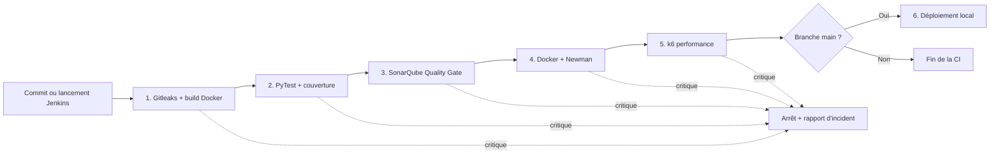

# PayFlex API - Pipeline CI/CD intelligent avec Jenkins

PayFlex est une API REST FastAPI utilisée comme support d'un pipeline Jenkins local. Cette solution ne nécessite ni GitHub Actions, ni compte GitLab, ni service CI externe.

## Architecture



Les stages Jenkins sont séquentiels. Lorsqu'un stage retourne un code non nul, Jenkins arrête automatiquement les stages suivants. Les blocs `post` conservent les rapports et nettoient les conteneurs temporaires.

## Installation locale de Jenkins

Prérequis : Docker Desktop ou Docker Engine avec Docker Compose.

```bash
docker compose -f docker-compose.jenkins.yml up -d --build
docker compose -f docker-compose.jenkins.yml exec jenkins \
  cat /var/jenkins_home/secrets/initialAdminPassword
```

Ouvrir ensuite `http://localhost:8080`, saisir le mot de passe initial et installer les plugins recommandés.

> Cet environnement est destiné au TP local. Le montage du socket Docker donne à Jenkins des privilèges élevés : ne pas exposer le port 8080 directement sur Internet.

Créer un job **Pipeline** :

1. sélectionner **Pipeline script from SCM** ;
2. choisir **Git** ;
3. utiliser `file:///opt/payflex-source` comme URL du dépôt ;
4. utiliser `*/main` comme branche ;
5. laisser `Jenkinsfile` comme chemin du script.

Le dépôt est monté en lecture seule dans Jenkins. Il faut donc valider les changements avec un commit local avant l'exécution du job, mais aucun push vers une plateforme externe n'est nécessaire.

## Pipeline détaillé

### 1. Confidentialité et construction

Le stage `Confidentialité et construction` effectue trois analyses Gitleaks :

1. historique Git complet ;
2. code source et fichiers de configuration suivis ;
3. contenu applicatif et métadonnées de l'image Docker.

La configuration `.gitleaks.toml` ajoute la détection de cartes bancaires potentielles et d'IBAN. La métrique est volontairement binaire puisque le seuil maximal toléré est zéro :

- aucune fuite : taux de confidentialité de 100 % ;
- fuite, rapport absent ou rapport invalide : taux de 0 % et arrêt.

L'image `payflex:<numéro-build>` est construite une seule fois. Les stages Newman, k6 et déploiement réutilisent exactement cette image.

### 2. Tests unitaires et couverture

PyTest génère `coverage.xml`, `junit.xml` et `pytest.log`.

| Couverture | Classification | Réaction |
|---|---|---|
| `>= 80 %` | Conforme | Continuer |
| `70 % à < 80 %` | Non critique | Warning |
| `< 70 %` | Critique | Arrêt et rapport |

Le log PyTest est ensuite analysé par Gitleaks.

### 3. Analyse SonarQube

Le pipeline lance une instance SonarQube Community éphémère et un scanner dans un réseau Docker isolé. Le Quality Gate bloque pour :

- une couverture inférieure à 70 % ;
- au moins un bug ;
- au moins une vulnérabilité.

Les code smells et la couverture comprise entre 70 % et 80 % restent des avertissements.

### 4. Tests d'intégration

L'image validée est lancée dans un conteneur éphémère. Newman contrôle :

- `GET /health` ;
- la création d'un paiement ;
- la consultation du paiement créé ;
- le refus d'un montant négatif ;
- la réponse 404 pour un identifiant inconnu.

Un crash ou un échec Newman est critique. Les logs Newman et applicatifs sont archivés et scannés.

### 5. Tests de performance

k6 exécute 20 utilisateurs virtuels pendant 30 secondes.

| Indicateur | Conforme | Warning | Critique |
|---|---:|---:|---:|
| Latence p95 | `<= 200 ms` | `> 200 et <= 500 ms` | `> 500 ms` |
| Taux d'erreur | `< 1 %` | `>= 1 et <= 2 %` | `> 2 %` |

Le taux effectif est le maximum entre les erreurs HTTP et les checks k6 en échec. Les seuils critiques existent dans k6 et dans `quality_gate.py`.

### 6. Déploiement local

Le stage ne s'exécute que pour la branche `main`. Il remplace le conteneur `payflex-production`, active le redémarrage automatique et réalise un smoke test avant de déclarer le déploiement réussi.

L'API déployée est disponible sur `http://localhost:8000` depuis la machine qui héberge Docker.

## Classification et rapports

Une erreur non critique laisse le pipeline continuer avec un message `WARNING`. Une erreur critique crée un fichier `incident-*.md`, marque le build en échec et bloque tous les stages suivants.

Jenkins archive automatiquement :

- les rapports Gitleaks ;
- `coverage.xml` et `junit.xml` ;
- les mesures SonarQube ;
- le rapport Newman ;
- `k6-summary.json` ;
- les logs et rapports d'incident.

## Trois scénarios pour les captures

Cliquer sur **Build with Parameters** et sélectionner :

- `success` : pipeline complet attendu au vert ;
- `performance_failure` : ajoute 600 ms de latence dans le conteneur de test et bloque au stage k6 ;
- `secret_leak` : crée un numéro de carte de test uniquement dans la copie scannée et bloque au premier stage.

Aucun vrai secret n'est ajouté au dépôt.

## Arrêt de Jenkins

```bash
docker compose -f docker-compose.jenkins.yml down
```

Cette commande conserve le volume `jenkins_home`. Pour éviter toute suppression accidentelle, le projet ne fournit pas de commande automatique supprimant ce volume.
