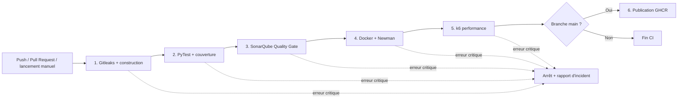

# PayFlex API — Pipeline CI/CD intelligent

PayFlex est une API REST FastAPI utilisée comme support d'un pipeline GitHub Actions avec tests multi-niveaux, analyse SonarQube, détection de données sensibles et arrêt automatique avant déploiement.

## Architecture du pipeline



Les jobs utilisent `needs`, donc un job critique en échec empêche automatiquement tous les jobs suivants de démarrer. L'image Docker est construite une seule fois, scannée, exportée, puis réutilisée sans reconstruction pour Newman, k6 et le déploiement.

## Déroulement détaillé

### 1. Confidentialité et construction

Le job `secrets-scan` effectue trois contrôles avec Gitleaks :

1. historique Git complet ;
2. code source et fichiers de configuration suivis par Git ;
3. contenu applicatif et métadonnées de l'image Docker.

La configuration `.gitleaks.toml` étend les règles standards avec la détection des numéros potentiels de carte bancaire et des IBAN. Le Quality Gate applique une métrique binaire, car le nombre maximal de fuites toléré est zéro :

- aucune fuite : taux de confidentialité = 100 %, pipeline autorisé ;
- au moins une fuite ou rapport absent/invalide : taux = 0 %, pipeline bloqué.

Après validation, l'image `payflex:<SHA du commit>` est sauvegardée comme artefact GitHub Actions. Tous les jobs suivants utilisent cette même image.

### 2. Tests unitaires et couverture

PyTest exécute les tests de l'API et produit :

- `coverage.xml` pour la couverture ;
- `junit.xml` pour le détail des tests ;
- `pytest.log` pour l'analyse et l'archivage.

La couverture est classifiée ainsi :

| Couverture | Classification | Réaction |
|---|---|---|
| `>= 80 %` | Conforme | Le pipeline continue |
| `70 % à < 80 %` | Non critique | Warning GitHub, le pipeline continue |
| `< 70 %` | Critique | Rapport d'incident et arrêt |

Le log PyTest est ensuite scanné par Gitleaks. Une fuite dans le log est critique.

### 3. Analyse statique SonarQube

Une instance SonarQube Community éphémère est lancée dans le runner. Le pipeline crée un Quality Gate contenant les conditions critiques suivantes :

- couverture inférieure à 70 % ;
- au moins un bug ;
- au moins une vulnérabilité.

Les code smells et une couverture entre 70 % et 80 % sont classés comme avertissements. Ils sont écrits dans le résumé GitHub et dans un rapport JSON, sans arrêter le pipeline.

### 4. Tests d'intégration

L'image déjà validée est chargée puis lancée dans un conteneur Docker éphémère. Newman exécute la collection Postman qui vérifie :

- l'état de santé de l'API ;
- la création d'un paiement ;
- la lecture du paiement créé ;
- le refus d'un montant négatif ;
- la réponse `404` pour un paiement inconnu.

Un échec Newman ou un crash de l'API est critique. Les logs Newman et applicatifs sont scannés avant destruction du conteneur.

### 5. Tests de performance

k6 exécute 20 utilisateurs virtuels pendant 30 secondes. Le taux d'erreur effectif est le maximum entre le taux d'erreurs HTTP et le taux d'échec des checks k6.

| Indicateur | Conforme | Warning | Critique |
|---|---:|---:|---:|
| Latence p95 | `<= 200 ms` | `> 200 ms et <= 500 ms` | `> 500 ms` |
| Taux d'erreur | `< 1 %` | `>= 1 % et <= 2 %` | `> 2 %` |

Les seuils critiques existent à la fois dans k6 et dans `quality_gate.py`. Le rapport `k6-summary.json`, les logs k6 et les logs applicatifs sont archivés et scannés.

### 6. Déploiement

Le déploiement n'est exécuté que pour un `push` réussi sur `main`. L'image précédemment testée est taguée avec le SHA du commit et publiée dans GitHub Container Registry :

```text
ghcr.io/<propriétaire>/<dépôt>:<sha-commit>
```

Une Pull Request, une branche de test ou un lancement manuel ne déclenche jamais le déploiement.

## Classification et fail-fast

Une erreur non critique produit une annotation `warning` et reste visible dans le résumé du job. Une erreur critique produit une annotation `error`, un fichier `incident-*.md`, un rapport JSON et un code de sortie non nul. GitHub Actions marque alors le job en échec et ignore les jobs dépendants, notamment le déploiement.

Les rapports sont publiés avec `if: always()` afin de rester téléchargeables même quand un job échoue.

## Exécuter les trois scénarios de preuve

Dans GitHub : **Actions → PayFlex CI/CD → Run workflow**, sélectionner `demo_scenario` :

- `success` : exécution normale attendue au vert ;
- `performance_failure` : ajoute 600 ms de latence uniquement dans le conteneur de test, le p95 dépasse 500 ms et le déploiement est bloqué ;
- `secret_leak` : crée à l'exécution un numéro de carte de test dans la copie à scanner, Gitleaks le détecte et bloque immédiatement le pipeline.

Ces scénarios n'ajoutent aucun vrai secret au dépôt et n'affectent pas le comportement normal de l'API.

## Exécution locale

```bash
python -m venv .venv
source .venv/bin/activate
pip install -r requirements.txt
pytest --cov=app --cov-report=xml
python scripts/quality_gate.py unit
docker build -t payflex:local .
docker run --rm -p 8000:8000 payflex:local
```

Pour k6 :

```bash
k6 run -e BASE_URL=http://127.0.0.1:8000 perf/load.js
python scripts/quality_gate.py perf
```
